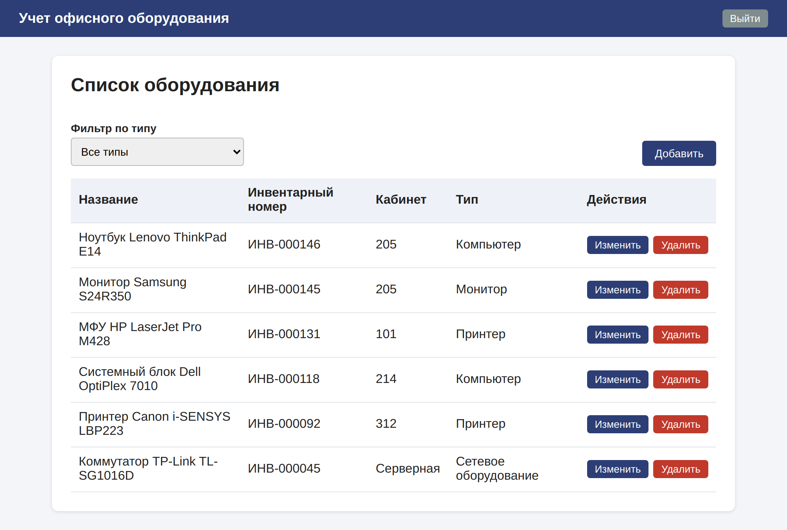

# Учет офисного оборудования

Разумнов Александр Сергеевич, ОДО-ИС09-23-2

Курсовая работа по МДК.09.01 «Проектирование, разработка и оптимизация веб-приложений».
Тема: «Разработка веб-приложения для учета офисного оборудования».

Текст курсовой: [docs/Курсовая_работа.docx](docs/Курсовая_работа.docx)

## Что умеет
- регистрация и вход (пароли хранятся в виде хэша BCrypt)
- добавление, редактирование и удаление оборудования: название, инвентарный номер, кабинет, тип
- фильтр по типу: компьютер, монитор, принтер, сетевое оборудование
- каждый пользователь видит только свое оборудование

## Технологии
Java 21, Maven, Spring Boot 3.3 (Web, Thymeleaf, Data JPA, Security, Validation), база H2 в файле, JUnit 5.

## Запуск
Нужны JDK 21 и Maven (или IntelliJ IDEA: открыть папку проекта и запустить класс `OfficeApplication`).

    mvn spring-boot:run

Открыть http://localhost:8080, зарегистрироваться и войти.

Сборка jar: `mvn clean package`, запуск: `java -jar target/office-equipment-1.0.0.jar`.

Если порт 8080 занят — поменяйте `server.port` в `src/main/resources/application.properties`.
Чтобы начать с пустой базой, остановите приложение и удалите папку `data`.

## Проверка
- `mvn test` — тест JUnit 5 для проверки регистрации (`RegistrationCheckTest`).
- При каждой загрузке на GitHub (вкладка Actions) проект собирается, запускается тест, затем само приложение,
  и скрипт `.github/check-scenarios.sh` проходит 12 сценариев из таблицы 8 курсовой.

## Структура
    src/main/java/ru/spbu/office/
        config/       настройки безопасности
        controller/   адреса и страницы
        model/        классы таблиц (User, Equipment, EquipmentType)
        repository/   запросы к базе
        service/      логика, проверка регистрации
    src/main/resources/templates/   HTML-шаблоны страниц
    src/test/java/                  тесты JUnit 5
